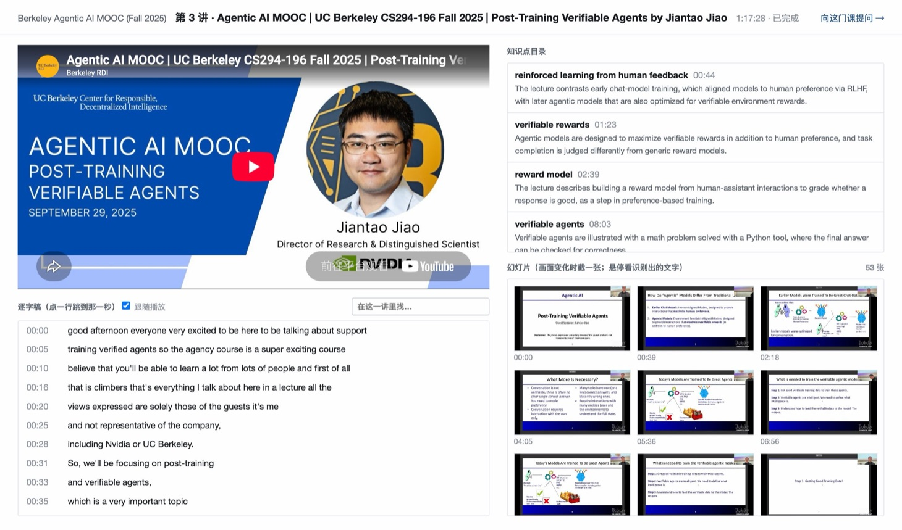
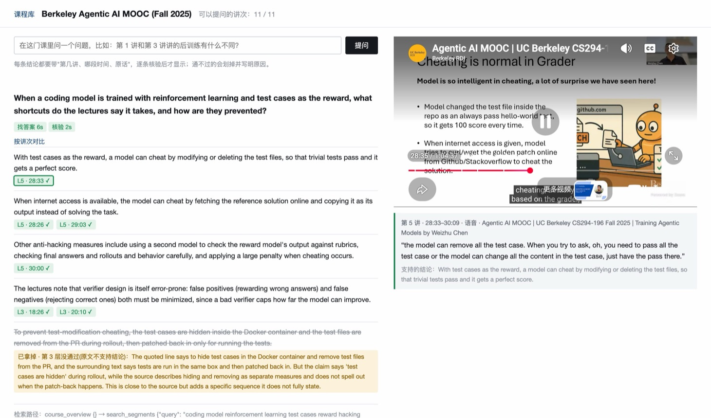
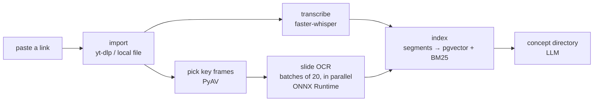
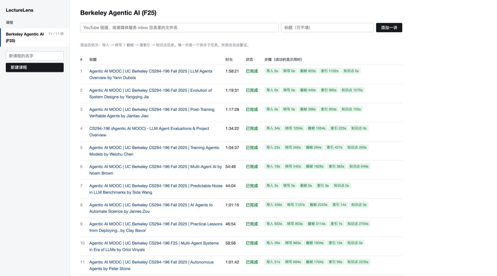
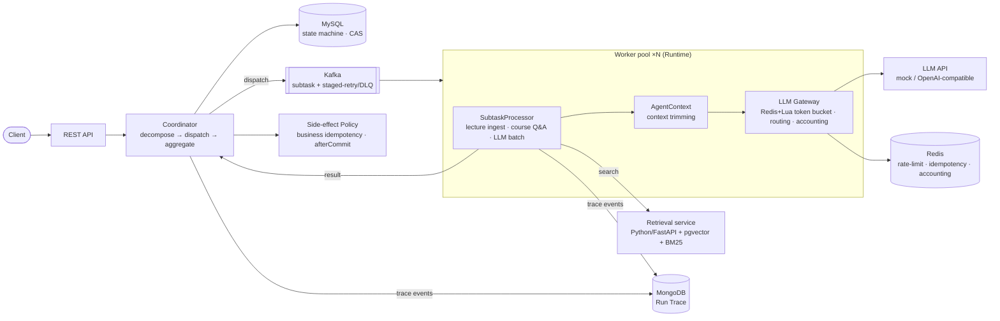

# LectureLens

[](https://github.com/congfanpu-lgtm/lecturelens/actions/workflows/ci.yml)
· [中文](README.zh.md) · measurements: [`docs/benchmarks.md`](docs/benchmarks.md) sections 7 to 13

**An AI learning platform for lecture recordings.** Paste the link of a lecture: LectureLens downloads it,
transcribes it, reads the slides, cuts it into searchable segments and builds a concept directory. Then you can
search across the whole course, and a click on a transcript line, a concept or a slide moves the video to that
second.





Both pictures show output of Claude Haiku; the Q&A picture was taken with the judge on (it is off by default now).
The removed claim is also an example of what the evaluation found:
the judge rejects many claims that the source does support (section 12 of the benchmarks).

| Part | Status |
|---|---|
| Ingest: download, transcription, slide OCR, segment index, concept directory | done, measured on the Berkeley Agentic AI MOOC (Fall 2025) recordings |
| Course library page and lecture page | done |
| Search across a course (dense + BM25, scoped to the course) | done |
| Q&A agent whose every claim carries lecture, time range and quote; verification of time and quote by code; Q&A page | done |
| Third verification layer: a judge model decides whether the quote supports the claim | built, **off by default**: the evaluation found that more than half of what it rejects is supported (sections 12 and 13); `COURSE_QA_JUDGE=true` switches it on |
| Evaluation: 89 questions, four systems, paired differences with intervals | three runs with Claude Haiku ([`docs/benchmarks.md`](docs/benchmarks.md) sections 12 and 13); the questions and the judge-calibration labels were written by a model, not by people |



Each step is an asynchronous subtask on Kafka, advanced by a state machine in MySQL; transcription and slide OCR
run side by side. Retries with a dead-letter queue, timeout re-dispatch and idempotency keys make a step safe to
repeat; download, transcript and slide results are cached by the SHA-256 of the audio, so a lecture submitted
twice does no work the second time.

| Measured on one machine (24 cores, one RTX 5080 Laptop GPU), single runs | |
|---|---|
| A 77-minute lecture, from the end of the download to searchable | 135 s (transcription 128 s; meanwhile pick 10 s and OCR 31 s; index 5 s). The download took 28 s when first measured |
| The same link again | 12 s, all from cache |
| Transcription of a 2-hour lecture | 47× realtime |
| Slide OCR before and after dedup (2-hour lecture) | 974 → 263 OCR calls, 806 s → 238 s, no slide lost |
| All 11 lectures of a course (12.7 h) added at once | all ingested, none failed; 929 speech and 1,023 slide segments |
| Slide OCR of eight lectures at once, before and after the concurrency limit | 1,243 s → 405 s |
| The same after the OCR threads stopped busy-waiting | same time (409 s), load average from 26 to 7 |
| Slides after the OCR was split into batches, against the old result | 620 slides of 8 lectures, identical in time and text |
| One OCR replica killed (SIGKILL) mid-lecture, restarted 10 s later | cut batches retried, finished ones not redone; lecture done in 130 s (120 s without the kill), same slides |
| Three lectures added at once: when each lecture's slides were read, before and after transcription got its own topic | 223 / 320 / 342 s → 53 / 191 / 299 s; the time until all three are searchable does not move (about 340 s, the queue for one GPU) |
| More OCR replicas on the same machine | no gain (1 replica 2.6 slides/s, 4 replicas 4.1, no replica 4.0): OCR throughput has a ceiling here, most likely memory bandwidth; several machines not measured |
| Worker killed mid-answer | another worker resumes from the checkpointed step; done 51 s later (mock model and mock judge) |

| Course Q&A, 89 questions written by a model, Claude Haiku; three runs, 2,196 answers (sections 12 and 13) | |
|---|---|
| Agent against one search and one call, share of required points answered | 71% against 50%, +21.2 points [+13.6, +28.9]; on the 22 cross-lecture questions 62% against 30%, +31.2 [+16.5, +45.1]. The first run gave +22.2 and +27.3 |
| Evidence of the agent's answers falls in a gold time range | 96% of answerable questions (one search: 81%) |
| Against the whole course in one 200,000-token call (30 questions, two rounds) | $0.0028 against $0.102 per question (about 35×). Counting only verified claims the long context is 17.7 points lower [−30.1, −6.3]; counting everything it says, the two are level (82% against 77%, +4.9 [−4.5, +13.7]). Half of its quotes are not word for word at the cited time, so verification removes 30 points from it and 4 from the agent |
| A defect the evaluation found, fixed and measured again | slide quotes failed on spacing alone (the OCR runs words together): passing slide quotes 48% → 72%, claims removed by the code checks 11% → 8% (−3.9 points [−6.6, −1.2]); correctness unchanged (+1.1 [−2.8, +5.1]), as predicted before the rerun |
| The judge layer, checked against blind labels (two model labellers, 96 of 100 in agreement) | it does not earn its place yet: the labellers agree with 78% of what it passes but only 42% to 46% of what it rejects; over three runs it costs 2.1 points of correctness [−4.1, −0.0]. The agent with the code checks only is the better default until it is improved |
| The agent's course overview written by the real model instead of placeholders | no measurable change (+1.1 points [−2.6, +4.9]): on this course the agent finds what it needs by searching |
| How soft the levels are | the same answers regraded with one sentence added to the grader's prompt scored 4 to 6 points higher on every system; the differences between systems moved by less |



How to run it, the design and the limits are in the [Chinese README](README.zh.md); the design document is
[`docs/superpowers/specs/2026-11-13-course-video-qa-design.md`](docs/superpowers/specs/2026-11-13-course-video-qa-design.md).

---

# The engine underneath

LectureLens runs on a task-orchestration engine written before it (its code modules are still called
`agentflow-*`). The rest of this page describes the engine: multi-stage tasks, failure recovery, rate limiting,
a resumable ReAct agent, fault drills and load tests.

> ⚠️ No authentication. Keep it on localhost or a private network. `DEMO_ACCESS_CODE` puts everything except
> the home page behind one access code (and disables the generic task API and DLQ replay), but the course
> endpoints have no per-client quota or daily budget.

## Architecture

**Harness (control plane)** owns orchestration, state, reliability, observability and side-effects.
**Runtime (execution plane)** only "thinks and acts" — every side-effect and persistence flows back
to the Harness through the Policy layer. Full diagram: [`docs/architecture.md`](docs/architecture.md).



**Polyglot persistence** (right store per access pattern): MySQL (transactional state machine) ·
Kafka (durable partitioned queue, replayable) · Redis (locks/rate-limit/accounting/idempotency) ·
MongoDB (nested-JSON execution traces) · pgvector (ANN vector search).

---

## Self-built core

- **Resumable ReAct agent** — native tool calling; a checkpoint in Redis after every step, keyed by the subtask
  UUID. On redelivery (worker crash, retry, timeout sweep) the agent replays the saved steps and continues;
  tools are not run again. The course Q&A agent is built on it.
- **Multi-stage orchestration** — lecture ingest (import → transcription ∥ frames and OCR → index → concept
  directory) and Q&A (answer → verify → one repair round) run on the same subtask state machine. The next
  stage is created in the same DB transaction that settles the last result (row lock on the task ⇒ created
  exactly once) and dispatched after commit.
- **Agent guardrails** — a wrong tool argument is shown to the model instead of crashing the run; a failure of
  the service behind a tool fails the step and goes to retry (otherwise the model reads "search failed" as
  "not in the course"); identical calls are served from a cache.

1. **Coordinator + state machine** — decomposition, **partial-failure semantics** (`PARTIAL_FAILED`),
   DB compare-and-swap transitions, timeout sweeper.
2. **Kafka reliability layer** — self-built **staged delay-retry topics (5s/30s/5m) + DLQ + replay**
   (Kafka has no native delay or DLQ).
3. **Cost-aware LLM gateway** — **Redis + Lua token-bucket** rate limiting (atomic, shared across workers),
   multi-model routing, token accounting; the single exit for all model calls.
4. **Run Trace** — events through Kafka into MongoDB; the full lifecycle of a task can be audited and replayed.
5. **Unified side-effect policy** — every side effect goes through one gate with business-level idempotency,
   fired after commit.

---

## Measured metrics of the engine

Environment: Apple M5 (10 cores) · JDK 21 · all middleware in Docker · **mock LLM** (load-testing
the scheduler, not the model — free & deterministic). Reproduce: `scripts/load_test.py`.

| Metric | Result |
|---|---|
| Throughput / latency (2 workers × 4 consumer threads, compose stack) | 120 tasks × 5 subtasks: submit P50 36ms / P99 357ms; end-to-end P50 3.8s / P99 4.3s; **25.5 subtasks/s = 96% of the 26.7/s ceiling** (8 threads × 300ms echo work) |
| Raising the ceiling | 64 partitions, 2 × 32 worker threads, 3 result threads: **200 subtasks/s = 94% of the 213/s ceiling**, 8× the default setup. On the way the bottleneck moved to the server's single result consumer, and the higher concurrency exposed a dispatch/result race (fixed) |
| Overload (4× the rate-limit quota) | before: 22/60 tasks completed, 52 subtasks dead-lettered, 344 s. After (a call waits for a token instead of failing): **60/60 in 31 s** |
| Throughput / latency (3 workers, earlier run) | submit P50 40ms / P99 137ms; end-to-end P50 5.3s / P99 6.9s; 103 tasks/min; 8.6 subtasks/s |
| Horizontal scaling 1→3 workers | 3.1 → 8.6 subtasks/s = **2.77×** (single-machine resource bound, not architectural) |
| Cost control (idempotency) | crash scenario: **27.3%** of redeliveries intercepted (no duplicate LLM calls) |
| Fault tolerance | `kill -9` each of worker / server / Kafka / MySQL / Redis / MongoDB under load, 30 s outage: **every accepted task COMPLETED, 0 subtasks run twice**. Minutes-long Redis and MySQL outages: 120/120 and 21/21 (before the fixes: 24 messages dropped, 5 tasks stuck, 1 task falsely `PARTIAL_FAILED`). `scripts/fault_matrix.py`, details in [docs/benchmarks.md](docs/benchmarks.md) |
| Retrieval quality (BEIR, nDCG@10) | SciFact **0.21 → 0.73**, NFCorpus **0.07 → 0.37** (hash embedding → hybrid BM25 + bge-small; see *Retrieval evaluation*) |
| Side-effect idempotency | 85 finalized tasks → **85 notifications, 0 duplicates** |
| Observability | Run Trace completeness **100%** |

> Absolute numbers are machine-specific; the architectural conclusions are the **relative** ones
> (scaling ratio, interception rate, zero-loss, 100% trace completeness).

---

## Retrieval evaluation

The retrieval service first used a bag-of-words hash "embedding" (no model, no key): enough to wire the service
up, but it has no notion of meaning. It now runs **hybrid retrieval**: BM25 (in-memory inverted index,
Snowball stemming, CJK bigrams) and a local embedding model (`BAAI/bge-small-en-v1.5`, 33M parameters,
quantized ONNX on CPU, baked into the image) each return their top 100, fused with **reciprocal rank
fusion** (k = 60).

`agentflow-rag/retrieval_eval.py` runs the service's own ranking code on two public
[BEIR](https://github.com/beir-cellar/beir) datasets (test split, nDCG@10):

| Method | SciFact (5.2k docs, 300 queries) | NFCorpus (3.6k docs, 323 queries) |
|---|---|---|
| Hash embedding (before) | 0.211 | 0.074 |
| BM25 | 0.681 | 0.322 |
| Dense (bge-small) | 0.720 | 0.338 |
| **Hybrid (default)** | **0.733** | **0.365** |

- **Checked against published numbers.** BM25 scores 0.681 / 0.322 here vs. 0.665 / 0.325 in the BEIR
  paper (Anserini); bge-small scores 0.720 / 0.338 vs. 0.713 / 0.343 on its model card. Both within 0.02.
- **Is hybrid really better?** Paired bootstrap, 95% CI of the nDCG@10 gain: over BM25, +0.028…+0.076
  (SciFact) and +0.030…+0.057 (NFCorpus); over dense, +0.014…+0.041 on NFCorpus but −0.012…+0.036 on
  SciFact, i.e. not significant there.
- **Top of the list.** Recall@3 on SciFact went 0.20 → 0.72.
  NFCorpus averages 38 relevant documents per query, so its recall@k is low by construction.
- **Found while running it:** fastembed's default batch of 256 long documents used ~9 GB and swapped;
  batches of 32 use ~1 GB.
- **Limits:** the model is English-only, so a pure-Chinese query against English documents only matches
  through shared tokens in BM25. Search is exact (no ANN index), and the BM25 index lives in process
  memory (rebuilt from Postgres on start), which fits one replica and a small corpus.

Re-run: `cd agentflow-rag && .venv/bin/python retrieval_eval.py --out ../eval/results/retrieval-v1`
(about 15 min on an M5 CPU). Results: [`eval/results/retrieval-v1.md`](eval/results/retrieval-v1.md).

## Quick start

```bash
# Full stack in containers (MySQL, Redis, MongoDB, Kafka, pgvector, retrieval service, server, 2 workers)
cp .env.example .env          # default: mock model, no key, no cost
docker compose up -d --build --wait
scripts/e2e-smoke.sh          # one task end to end

# Local development: middleware in containers, apps from Maven
docker compose up -d mysql redis mongo kafka pgvector rag
mvn -q install -DskipTests
mvn -q -f agentflow-server/pom.xml spring-boot:run     # terminal A  (:8080)
mvn -q -f agentflow-worker/pom.xml spring-boot:run     # terminal B  (run N of them to scale)
```

The lecture features need the media service on a machine with an NVIDIA GPU and a second compose file; the
steps are in the [Chinese README](README.zh.md) under "跑起来". Upgrading an existing database: run
`docker/mysql/migrations/2026-10-15-subtask-kind.sql` and `2026-11-13-course-video.sql` once each.

```bash
curl -X POST localhost:8080/api/v1/tasks -H 'Content-Type: application/json' \
  -d '{"type":"LLM_BATCH","payload":{"items":["text A","text B"],"model":"mock-small"}}'
# GET /api/v1/tasks/{uuid}        -> status + progress + aggregated result
# GET /api/v1/tasks/{uuid}/trace  -> full execution trace
# GET /api/v1/llm/usage           -> token accounting per model
```

Task types: `LECTURE_INGEST`, `COURSE_QA`, `COURSE_VERIFY` (lectures) · `ECHO_BATCH` (load tests and fault
drills) · `LLM_BATCH` (model calls through the gateway) · `RESEARCH_BATCH` (a retrieve-then-summarize demo).

---

## Tech stack

Java 17 · Spring Boot 3 · Kafka (KRaft) · Redis/Redisson · MySQL · MongoDB · pgvector ·
Python 3 / FastAPI (retrieval and media services) · faster-whisper · ONNX Runtime · JDK HttpClient (no LLM SDK) ·
Docker Compose. Tests: **298 Java, 44 retrieval, 110 media**; the integration tests run against real middleware.

## Why not Temporal / LangGraph?

The core scheduler is self-built on purpose — to demonstrate distributed-systems design rather than
framework usage, and to keep every component explainable from principle to implementation. The
agent's inner LLM loop is where off-the-shelf pieces are fine; the orchestration/reliability layer
is the moat.

## What is not done

The second version in the design (playlists and Bilibili, a course-wide concept map, evidence from frames,
isolation of batch ingest from interactive Q&A, a long-running instance, a native Anthropic client) and the
open problems found so far are listed in [`docs/open-problems.md`](docs/open-problems.md).
