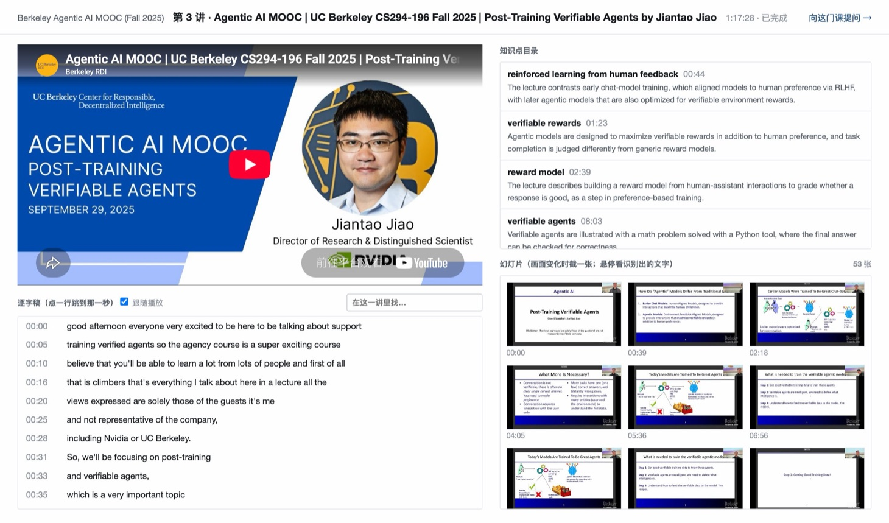
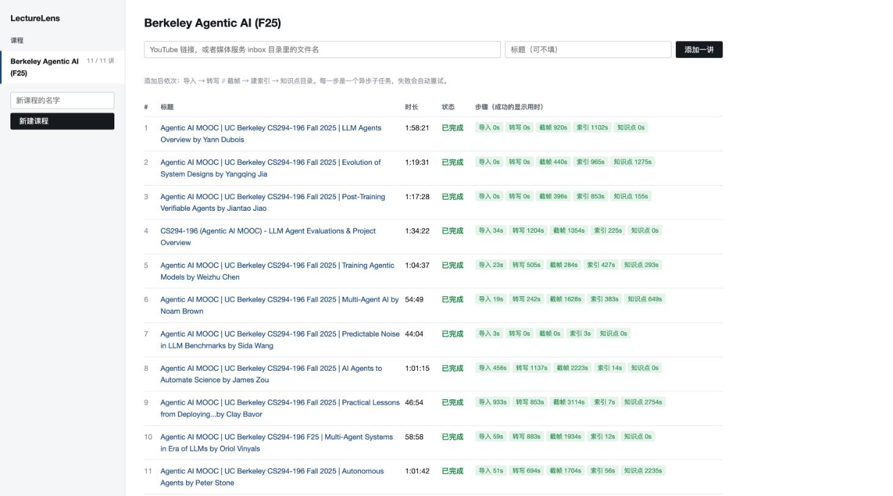
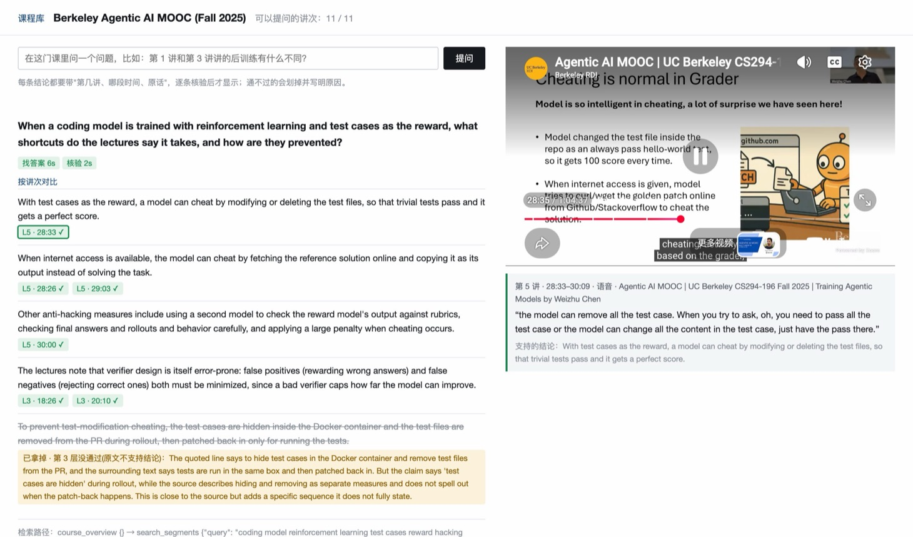
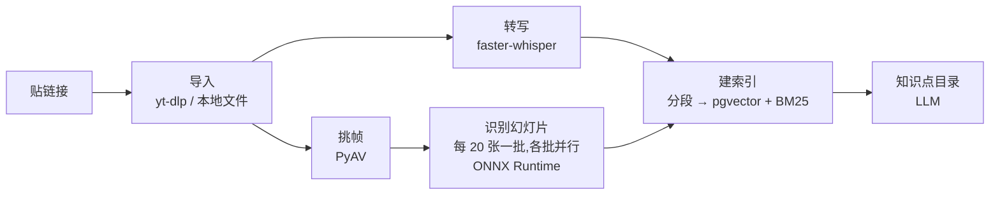

# LectureLens

> AI 课程视频学习平台 · [English](README.md) · 实测数据:[`docs/benchmarks.md`](docs/benchmarks.md) 第 7 到 13 节 ·
> 设计文档:[`docs/superpowers/specs/2026-11-13-course-video-qa-design.md`](docs/superpowers/specs/2026-11-13-course-video-qa-design.md)

贴一个课程录播的链接,LectureLens 把这一讲下载、转写、识别幻灯片、切成可检索的片段,并生成知识点目录。
之后可以在整门课的范围里提问:agent 自己决定查哪几讲,每条结论都带着"第几讲、哪段时间、原话是什么",
由代码逐条核验,通不过的结论会被拿掉并写明原因。点一个证据、一句逐字稿、一个知识点或一张幻灯片,视频就跳到那一秒。

(图里的知识点目录由 Claude Haiku 生成;课程环境默认用模拟模型,不配 key 时目录是占位内容。)

(问答页的图是 Claude Haiku 的真实回答,截图时判官还开着,现在默认关闭。被拿掉的那一条也说明了判官的问题:原文其实说了这些做法,判官嫌结论把它们连成了一个顺序——实测判官否掉的结论一半以上有原文支持,见 benchmarks 第 12 节。)

## 现在的状态

| 部分 | 状态 |
|---|---|
| 摄入:下载、语音转写、幻灯片识别、分段索引、知识点目录 | 已完成,在 Berkeley Agentic AI MOOC(2025 秋)的课程录播上实测 |
| 课程库页、单讲页(播放器、逐字稿、知识点目录、幻灯片,点击跳转) | 已完成 |
| 整门课范围的检索(向量 + BM25 混合,按课程隔离) | 已完成 |
| 问答 agent:自己决定查哪几讲、搜什么;每条结论带"第几讲、哪段时间、原话" | 已完成 |
| 核验:代码核对时间是否合法、引文是否真的在那一段里,通不过的结论拿掉并写明原因;第三层"原文是否支持结论"由判官模型判断 | 已完成。判官**默认关闭**:评测发现它否掉的结论一半以上有原文支持(第 12、13 节),`COURSE_QA_JUDGE=true` 可以打开 |
| 问答页:证据标签点了跳到视频的那一秒,被拿掉的结论划掉并写明原因 | 已完成 |
| 评测:89 道题、四套系统对比、逐题配对的差值和置信区间 | 已跑三轮(Claude Haiku,见 [`docs/benchmarks.md`](docs/benchmarks.md) 第 12、13 节);题集和判官校准的标注都是模型做的,不是人工 |

## 一讲课是怎么处理的

每一步是 Kafka 上的一个异步子任务,由 MySQL 里的状态机推进;转写(占显卡)和"挑帧 → 识别"(占 CPU)两条线并行。
转写有自己的 topic 和消费线程:它等显卡的那几分钟不占别的子任务的线程。

- **失败恢复**:重试 Topic(5 秒 / 30 秒 / 5 分钟)加死信队列,超时巡检重投,Redis 幂等键防止重复执行。
  链接不合规这类重试也没用的错误直接判失败,不走重试阶梯。
- **不重复干活**:下载、转写、幻灯片识别的结果按音频内容的 SHA-256 缓存。同一讲再提交一次,12 秒完成,不下载、不转写、不识别。
- **转写**:一讲一个子任务,整段交给 faster-whisper 批量推理,一张显卡上同一时刻只跑一路。
  实测 1、2、3 个 worker 并行转写吞吐不变、显存线性上涨,所以不切片分发。
- **幻灯片**:只解码关键帧;先找出画面里一直在动的区域(讲者的摄像头小窗)并忽略,画面真的变了才做文字识别;
  文字相近的读数只留最完整的一次。识别按 20 张一批拆成子任务,某一批失败只重试那一批;
  每个 worker 可以配自己的识别副本(另一台机器上的一个无状态进程)。
- **检索**:片段进 pgvector 的 `segments` 表,向量和 BM25 两路用 RRF 融合,每一路都限定在一门课里。
- **知识点目录**:模型看到按时间编号的片段,只输出"知识点 + 片段编号",时间由代码按编号查出来,
  所以目录里不会出现这一讲里不存在的时间点。

## 实测

一台 24 核、一张 RTX 5080 Laptop(16GB)的机器,一次运行的结果。详见 [`docs/benchmarks.md`](docs/benchmarks.md) 第 7 到 13 节。

| | 结果 |
|---|---|
| 77 分钟的一讲,下载之后到可以检索 | 135 秒(转写 128;同时挑帧 10、识别 31;建索引 5)。下载另算,首次测量是 28 秒 |
| 同一个链接再加一次 | 12 秒,全部命中缓存 |
| 转写(2 小时的课,单独跑) | 47 倍实时,1298 条带时间戳的句子 |
| 截帧去重前后(2 小时的课) | 文字识别 974 次 → 263 次,806 秒 → 238 秒,没有丢页 |
| 播放列表链接(不支持) | 立即失败并写明原因,不重试 |
| 整门课 11 讲(12.7 小时)一次全部加入 | 全部成功;929 个语音片段、1023 个幻灯片片段。排队时的表现和发现的问题见 benchmarks 第 8 节 |
| 8 讲同时识别幻灯片,限流前后 | 1243 秒 → 405 秒 |
| 同上,关掉识别线程的空转之后 | 耗时不变(409 秒),机器的负载从 26 降到 7 |
| 识别拆成批之后,结果和原来比 | 8 讲 620 张幻灯片,时间和文字逐字相同 |
| 识别到一半强杀一个识别副本,10 秒后拉起 | 被打断的批次重试成功,做完的不重做;这一讲 130 秒完成(不杀是 120 秒),结果不变 |
| 在同一台机器上加识别副本 | 没有用:1 个 2.6 张/秒,4 个 4.1 张/秒,不起副本 4.0 张/秒。这台机器的识别吞吐有上限(最可能是内存带宽);换到多台机器上的效果没有测过 |
| 回答到一半杀掉 worker | 另一个 worker 从存档的那一步续跑,检索不重跑,51 秒后答完(模拟模型和模拟判官) |
| 三讲同时加入,各讲幻灯片读完的时间(转写改走独立队列前后) | 223 / 320 / 342 秒 → 53 / 191 / 299 秒;三讲全部可检索的时间不变(约 340 秒,卡在一张显卡的排队上) |
| 测试 | Java 298 个、检索服务 44 个、媒体服务 110 个 |

问答评测(Claude Haiku,89 道由模型出的题;三轮共 2,196 次问答,详见 benchmarks 第 12、13 节):

| | 结果 |
|---|---|
| agent 对比"检索一次、调用一次",答到的要点占比 | 71% 对 50%,差 21.2 点 [13.6, 28.9];22 道跨讲次题上 62% 对 30%,差 31.2 点 [16.5, 45.1]。第一轮是 22.2 点和 27.3 点 |
| agent 的证据落在标准时间段里 | 96%(检索一次:81%) |
| 对比"整门课约 20 万 token 放进一次调用"(30 道题,两轮) | 每问 0.0028 美元对 0.102 美元(约 35 倍)。只算通过核验的结论,长上下文低 17.7 点 [6.3, 30.1];它说的全算上,两者持平(82% 对 77%,差 4.9 点 [−4.5, 13.7])。它一半的引文不是那段时间里的原话,核验拿掉它 30 个点、拿掉 agent 4 个点 |
| 评测查出的缺陷,修了再测 | 幻灯片引文只因为空格不同就过不了核验(识别文字把词连在一起):通过率 48% → 72%,被前两层拿掉的结论 11% → 8%(差 3.9 点 [1.2, 6.6]);答对率没变(+1.1 点 [−2.8, 5.1]),和重跑之前写下的预期一致 |
| 判官这一层,对照盲标(两位模型标注者,100 对里 96 对一致) | 现在还不值它的成本:它放行的结论标注者认同 78%,它否掉的只认同 42% 到 46%;三轮合起来它让答对率低 2.1 点 [0.0, 4.1]。在改好之前,不带判官是更好的默认配置 |
| agent 的课程概览从占位内容换成真实模型生成的 | 没有可测的变化(+1.1 点 [−2.6, 4.9]):这门课上 agent 靠检索就找得到 |
| 答对率的绝对值有多软 | 同样的答案,给打分模型的提示多一句话再打一遍,每套系统都高了 4 到 6 个点;系统之间的差距变化更小 |

## 跑起来

需要一台有 NVIDIA 显卡的机器(转写)和 Docker。都用模拟模型,不需要 key。

    # 1. 媒体服务(下载、转写、截帧识别),跑在有显卡的宿主机上
    cd agentflow-media
    python3.12 -m venv .venv && .venv/bin/pip install -r requirements.txt -r requirements-gpu.txt
    MEDIA_HOST=$(docker network inspect bridge -f '{{(index .IPAM.Config 0).Gateway}}') MEDIA_ROOT=~/lecturelens-data ./run.sh

    # 2. 其余的服务(MySQL、Kafka、Redis、MongoDB、pgvector、检索服务、server、2 个 worker)
    ./scripts/course-env.sh up
    open http://127.0.0.1:18090/courses.html      # 课程库;问答页是 /qa.html?course=<课程 id>

媒体服务和课程功能的更多细节在下文的"媒体服务"和"课程录播"两节。

当前的范围限制:只支持单个 YouTube 视频和本地文件(播放列表、B 站还没有);本地文件能摄入但不能在页面里播放;
课程环境默认用模拟模型:不配 key 时页面上的知识点目录和问答是占位内容,只说明流程通了;真实模型下的问答质量见 `docs/benchmarks.md` 第 12、13 节。
还没解决的问题记在 [`docs/open-problems.md`](docs/open-problems.md)。

## 目录

| 目录 | 内容 |
|---|---|
| `agentflow-media/` | Python / FastAPI:下载、转写、截帧识别,结果按内容哈希缓存 |
| `agentflow-server/` | Java / Spring Boot:课程和讲次、任务状态机、阶段推进、接口、页面 |
| `agentflow-worker/` | Java / Spring Boot:消费子任务,摄入的五个处理器、分段、LLM 调用 |
| `agentflow-rag/` | Python / FastAPI:pgvector 上的片段索引和混合检索 |
| `docs/` | 设计文档、实施计划、实测记录 |

模块名里的 agentflow 是底层任务编排引擎的名字。

---

# 底层:任务编排引擎

LectureLens 建在一个自己写的分布式任务编排引擎上(代码模块名还是 `agentflow-*`)。下面是引擎本身的说明:
多阶段任务、失败恢复、限流、可续跑的 ReAct agent、故障演练和压测。

- **可续跑的 ReAct agent**:每一步存档到 Redis(key = 子任务 UUID);重新投递(worker 崩溃、重试、超时兜底)时
  回放已完成步骤后继续,工具不重复调用。课程问答用的就是它,回答到一半杀掉 worker 的演练见上面的实测表。
- **多阶段编排**:一讲课的摄入(导入 → 转写 ∥ 挑帧、识别 → 建索引 → 知识点目录)和问答(作答 → 核验 → 补一轮)
  复用同一套子任务状态机;下一阶段在"落定最后一个结果"的同一事务里创建(task 计数行锁 ⇒ 只创建一次),事务提交后再分发。
- **agent 防护**:工具参数写错时把错误回传给模型而不是崩溃;工具背后的服务出故障时整步失败、交给重试
  (否则模型会把"检索失败"当成"课里没讲");重复调用走缓存;每条结论的时间和引文由代码核对。

> ⚠️ 没有鉴权:只在本机 / 内网使用;对公网开放前必须先加鉴权,尤其是配置了真实 LLM key 时。
> `DEMO_ACCESS_CODE` 可以把首页以外的所有请求锁在一个访问码后面(同时禁用通用任务提交和死信重放),
> 但课程接口没有按来源的配额和每日预算。

## 架构(当前骨架)

用户 → API(8080) → 协调器拆解 → Kafka(AGENTFLOW_SUBTASK) → Worker 池
→ 回传(AGENTFLOW_RESULT) → 状态机聚合 → 查询结果

## 快速开始

前置:JDK 17+、Maven 3.9+、Docker(OrbStack / Docker Desktop)。

    docker compose up -d                          # MySQL/Redis/Kafka(KRaft)/MongoDB
    mvn -q -pl agentflow-server -am spring-boot:run   # 终端 A
    mvn -q -pl agentflow-worker -am spring-boot:run   # 终端 B
    ./scripts/e2e-smoke.sh                        # 终端 C:端到端验证

提交任务:

    curl -X POST localhost:8080/api/v1/tasks -H 'Content-Type: application/json' \
      -d '{"type":"ECHO_BATCH","payload":{"items":["hello","world"]}}'

查询:`GET /api/v1/tasks/{taskUuid}`

任务类型:`LECTURE_INGEST`、`COURSE_QA`、`COURSE_VERIFY`(课程录播);`ECHO_BATCH`(压测和故障演练用)、
`LLM_BATCH`(经网关批量调模型)、`RESEARCH_BATCH`(先判断要不要检索、再摘要的演示)。

老数据库升级:依次执行 `docker/mysql/migrations/` 里的 `2026-10-15-subtask-kind.sql` 和 `2026-11-13-course-video.sql`。

## 多 Worker 水平扩展

主 topic 8 分区,每个 Worker 4 个消费线程(同消费组自动 rebalance):

    # 终端各起一个,同 group 自动分走分区
    mvn -q -pl agentflow-worker -am spring-boot:run
    mvn -q -pl agentflow-worker -am spring-boot:run
    mvn -q -pl agentflow-worker -am spring-boot:run

优雅停机:`Ctrl-C` 后 Worker 处理完在途子任务、提交 offset 再退出,配合幂等去重保证不丢不重。
(1→3 Worker 吞吐提升比在 W8 压测量化。)

## 可观测与治理(Run Trace + Policy)

**Run Trace(事件溯源 → MongoDB 回放)**:server/worker 各组件在每个生命周期节点(提交、拆解、
分发、worker 接收/处理/回传、子任务落定、超时重投、DLQ 恢复、任务终态落定……)统一经
`TraceEmitter.emit(traceId, taskId, subtaskId, stage, status, detail)` 发一条 `TraceEvent` 到
Kafka `AGENTFLOW_TRACE` topic;server 侧唯一的 `TraceConsumer` 消费落 MongoDB(`trace_event`
集合,一事件一文档)。`traceId = String.valueOf(taskId)`,对外用 `taskUuid` 反查。
`GET /api/v1/tasks/{taskUuid}/trace` 按时间排序返回完整轨迹,可回放/审计"闭环是否执行成功"
(是否一路走到 `TASK_FINALIZED`)。经 Kafka 而非各处直写 Mongo 的原因:统一出口(Mongo 只在
`TraceConsumer` 一处被写)、保存时机是"状态变更即刻 emit、先落 Kafka 落盘再落 Mongo"(消费者/
进程崩溃也不丢事件)、worker 侧无需引入 Mongo 依赖。

**统一副作用 Policy 层**:所有有外部/持久后果的动作(通知、建 case 等)必须经
`SideEffectPolicy.execute(businessKey, action)` 这一个闸执行——不给旁路。用 Redis
`setIfAbsent(key, ttl)` 做业务级幂等:同一 `businessKey`(如 `notify:<taskUuid>`)首次执行
并占位,重复触发直接跳过("副作用去重跳过"日志),防止重复入队/二次 finalize 导致重复发通知。
执行失败会释放占位键,保证失败的副作用允许被重试而不会被"假幂等"卡死。代表性接入:
`TaskFinalizer` 判定终态后调用 `NotificationService.notifyTaskFinished`,均经 Policy 闸。

演示脚本:`./scripts/trace-demo.sh`(提交任务 → 轮询到 COMPLETED → 打印完整 trace)。

## LLM 网关与可控 Agent(W5–6)

**LLM 网关(唯一出口)**:所有 LLM 调用只能经 `LlmGateway.chat(ChatRequest)`——业务代码拿不到底层
`LlmClient`,没有旁路(代码层 enforce)。网关职责:① 多模型路由(按 `model` 选桶 + 计价)
② 限流 ③ 调用 ④ token 记账。默认后端 `MockLlmClient`(确定性、不烧钱、无需 API key,压测/单测都用它);
`llm.provider=openai` 切真实模型(OpenAI 兼容协议,JDK HttpClient,base-url/key 走环境变量)。

**Redis + Lua 令牌桶限流**:桶状态存 Redis(跨 worker 实例共享,水平扩展下限流才是全局的),
"读令牌→按时间补充→判够→扣减→回写"整段用一个 Lua 脚本原子执行(Redis 单线程 = 天然原子,
免分布式锁,与状态机用 MySQL CAS 同源)。扣不到令牌 → 先排队等(最多 `llm.max-wait-ms`,默认 60 秒),
等不到才抛 `RateLimitedException` 交 W3 阶梯重试。

**token 记账**:每次调用把 prompt/completion token 数 + 估算成本(微美元)原子累加到 Redis;
`GET /api/v1/llm/usage` 按模型返回累计 token 与成本(简历指标3/6 数据源)。

**AgentContext(防上下文膨胀)**:`AgentContext.build(system, input, history)` 按 token 预算裁剪——
超预算优先丢最老历史,历史丢光仍超则截断超长输入(保留头尾),裁剪量记日志。绝不无上限塞给模型。

**Skill 动态注册 + schema 约束输出**:实现 `Skill` 接口 + `@Component` 即被 `SkillRegistry` 自动收录
(动态加载);多个 skill 命中同一 intent 按 `priority` 排序;每个 skill 声明 `outputSchema`,LLM 输出
必须过 `SchemaValidator` 校验,不合规视为失败交重试——**输出稳定是代码层校验,不是求模型听话**。

**真 Agent**:新任务类型 `LLM_BATCH`,worker `LlmProcessor`(Runtime)= AgentContext 组 prompt →
网关调模型 → 按 skill schema 校验输出;`SubtaskListener` 按 `msg.type` 路由到处理器(策略模式,
Echo/LLM 并存)。副作用一律回 Harness 经 Policy——处理器不产生外部副作用。

提交 LLM 任务(默认 mock):

    curl -X POST localhost:8080/api/v1/tasks -H 'Content-Type: application/json' \
      -d '{"type":"LLM_BATCH","payload":{"items":["文本A","文本B"],"model":"mock-small"}}'

演示脚本:`./scripts/w5-6-demo.sh`(提交 LLM_BATCH → 打印结果 + trace + `GET /llm/usage` 记账)。

## RAG 检索与多角色 Agent(W7)

**独立 Python/FastAPI RAG 微服务(`agentflow-rag/`)**:跨语言架构——Java 主链路 + Python
embedding 生态。`/rag/ingest` 灌库、`/rag/search` 检索、`/health` 探活;向量存 **pgvector**
(`documents(id,content,embedding vector(384))`,余弦 `<=>` 精确检索)。
- **语义向量**:本地 ONNX 模型 `BAAI/bge-small-en-v1.5`(fastembed,CPU 即可,无需 API key;构建镜像时下载进去,
  运行时不联网)。`RAG_EMBED_MODEL=hash` 可切回旧的词哈希向量(离线兜底、评测对照组)。
- **混合检索(默认)**:BM25 关键词(内存倒排,英文词干 + 中文二元组)和语义向量各取前 100,
  用 **RRF** 按名次融合;`mode` 参数可单独用 `dense` / `bm25`。
- **换模型不丢数据**:模型名记在向量列的注释里,模型变了(维度相同也算)启动时在同一事务里按新模型重新编码全部文档。
- **评测**:`retrieval_eval.py` 用服务自己的排序代码,在两个 BEIR 公开数据集上对比(测试集,nDCG@10):

  | 方法 | SciFact(5.2k 文档 / 300 查询) | NFCorpus(3.6k 文档 / 323 查询) |
  |---|---|---|
  | 词哈希向量(改造前) | 0.211 | 0.074 |
  | BM25 | 0.681 | 0.322 |
  | 语义向量(bge-small) | 0.720 | 0.338 |
  | **混合检索(默认)** | **0.733** | **0.365** |

  - 和公开数字核对:BM25 论文值 0.665 / 0.325(BEIR 论文,Anserini),bge-small 官方值 0.713 / 0.343,都在 0.02 以内。
  - 混合比单路好多少(按查询配对 bootstrap,nDCG@10 提升的 95% 置信区间):比 BM25 +0.028~+0.076(SciFact)、
    +0.030~+0.057(NFCorpus);比语义向量在 NFCorpus 上 +0.014~+0.041,在 SciFact 上 −0.012~+0.036,不显著。
  - agent 实际拿到前 3 条:SciFact 的 Recall@3 从 0.20 到 0.72。
  - 跑评测时发现:fastembed 默认一批 256 篇长文档要 ~9GB 内存而换页,改成 32 篇约 1GB。
  - 局限:模型只懂英文,纯中文查询对英文文档只能靠 BM25 里的共同词;精确检索无 ANN 索引;BM25 索引在进程内存里
    (启动时从库重建),适合单副本、小语料。
  - 复跑:`cd agentflow-rag && .venv/bin/python retrieval_eval.py --out ../eval/results/retrieval-v1`(M5 CPU 约 15 分钟)。
  - `tests/test_recall.py` 是项目自己的 14 条小标注集(含 8 条改写过的问法),回归检查用:Recall@3 BM25 0.75、
    语义 0.89、混合 0.96。

**意图驱动检索 + 多角色**:worker 经 `RagClient`(唯一检索入口,与 LLM 经网关同构)调 RAG 服务。
新任务类型 `RESEARCH_BATCH` 由 `ResearchProcessor` 处理,是一条子任务内的角色流水:
router(意图判断是否需要检索)→ retriever(**命中才检索**,不是每步都查)→ AgentContext 注入资料
→ summarizer(经网关调 LLM)→ RagSearchSkill schema 校验。跨子任务的聚合(汇总)由 `TaskFinalizer`
完成。检索只读、不产生副作用故不经 Policy。

启动 RAG 服务(pgvector 与 RAG 已合入 `docker-compose.yml`):

    docker compose up -d pgvector rag              # RAG 服务(:8000,可用 .env 的 RAG_PORT 改宿主机端口)

提交研究任务(mock LLM + 本地 embedding 模型,离线可跑):

    curl -X POST localhost:8080/api/v1/tasks -H 'Content-Type: application/json' \
      -d '{"type":"RESEARCH_BATCH","payload":{"questions":["kafka 如何重分配分区?","hello there"],"model":"mock-small"}}'

演示脚本:`./scripts/w7-rag-demo.sh`(灌库 → RESEARCH_BATCH:需检索项 `usedRag=true` 带
`retrieved` ids;不需项 `usedRag=false` 不检索)。

### 媒体服务(agentflow-media,课程录播)

课程录播问答的第一块:给一个 YouTube 链接或本地文件,下载、转写成带时间戳的文本、截出幻灯片并识别
上面的文字。结果按音频内容的哈希缓存在磁盘上,同一讲不会重复下载、转写、识别。转写用 faster-whisper,
需要 NVIDIA 显卡,所以它不在 `docker-compose.yml` 里,直接跑在有显卡的宿主机上:

    cd agentflow-media
    python3.12 -m venv .venv && .venv/bin/pip install -r requirements.txt -r requirements-gpu.txt
    MEDIA_ROOT=~/agentflow-media-data ./run.sh     # 只监听 127.0.0.1:8010,必须单进程

    curl -X POST localhost:8010/media/import -H 'Content-Type: application/json' \
      -d '{"url":"https://www.youtube.com/watch?v=..."}'        # 返回 mediaKey
    curl -X POST localhost:8010/media/<mediaKey>/transcribe      # 一小时的课约 1 到 1.5 分钟
    curl -X POST localhost:8010/media/<mediaKey>/frames          # 挑出画面变了的帧并识别(一步到位)
    # 引擎用的是拆开的三步:…/frames/pick → …/frames/batches/<n>/ocr(每批 20 张)→ …/frames/merge
    # 识别副本:MEDIA_SOURCE=http://<媒体服务> MEDIA_PORT=8011 ./run.sh(或 scripts/ocr-replicas.sh up <N>)

课程录播的整套环境和测试(都是隔离的 compose 项目,固定用模拟模型,不碰日常那套):

    ./scripts/course-env.sh up          # 整套服务,server 在 127.0.0.1:18090;用完 down
    ./scripts/course-env.sh test-up     # 只有中间件;然后 test-java test、test-rag;用完 test-down

server 和 worker 在容器里,要访问宿主机上的媒体服务,所以媒体服务得监听容器网关的地址:
`MEDIA_HOST=$(docker network inspect bridge -f '{{(index .IPAM.Config 0).Gateway}}') ./run.sh`
(不要用 `0.0.0.0`,那会把服务暴露到局域网)。

本地文件放进 `MEDIA_ROOT/inbox/` 后用 `{"path":"文件名"}` 导入。测试不联网、不需要显卡:
`cd agentflow-media && .venv/bin/python -m pytest -q`。接口表见
`docs/superpowers/plans/2026-11-13-course-video-1-media-service.md`,设计见
`docs/superpowers/specs/2026-11-13-course-video-qa-design.md`。

### 课程录播(课程库页 / 单讲页)

贴一个 YouTube 链接(或填媒体服务 inbox 里的文件名),AgentFlow 把这一讲变成可检索的片段。
一讲是一个 `LECTURE_INGEST` 任务,每一步都是普通子任务,重试、超时重投、幂等、trace 都是引擎现成的:

    导入 → 转写 ∥(挑帧 → 识别幻灯片,每 20 张一批)→ 建索引 → 知识点目录

- 重活在媒体服务里做,子任务只带 `mediaKey` 和计数;逐字稿不经过 Kafka 和 MySQL。
- 转写是一讲一个子任务,不切片并行:实测一张显卡上多个 worker 并行转写没有收益(`docs/benchmarks.md` 第 7 节)。
- 导入或转写失败,整讲失败;挑帧、某一批识别或知识点目录失败算"部分完成",语音片段照样能检索。
- 识别不等转写:挑帧一完成就建各批识别。引擎一般是"当前子任务全部落定才进下一阶段",
  任务类型可以声明每落定一个子任务就问一次下一步(`TaskDecomposer.advancesEarly`)。
- 链接不合规这类重试也没用的错误直接判失败,不走 5 秒 / 30 秒 / 5 分钟的重试阶梯。
- 片段进 pgvector 的 `segments` 表,检索按课程隔离(`POST /segments/search`);写入是整讲替换,重复执行不会留下两份。
- 知识点目录:模型看到按时间编号的片段,只输出"知识点 + 片段编号",时间由代码按编号查出来。

功能默认关闭(`agentflow.course.enabled=false`):公开 demo 用的是同一份代码,不能让路人触发下载和转写。
`./scripts/course-env.sh up` 起的环境里是打开的,页面在 `http://127.0.0.1:18090/courses.html`。

当前的范围限制:只支持单个 YouTube 视频和本地文件(播放列表、B 站还没有);本地文件能摄入但不能在页面里播放;
课程环境默认用模拟模型:不配 key 时页面上的知识点目录和问答是占位内容,只说明流程通了;真实模型下的问答质量见 `docs/benchmarks.md` 第 12、13 节。
实测见 `docs/benchmarks.md` 第 8 节,设计见 `docs/superpowers/specs/2026-11-13-course-video-qa-design.md`。

## 压测与指标(W8)

零依赖 Python 压测脚本 `scripts/load_test.py`(标准库并发提交+轮询,测**端到端完成延迟**而非
纯 HTTP 延迟),全程 mock LLM 不烧钱。实测(环境:Apple M5 / JDK 21 / 中间件全 Docker;负载 ECHO_BATCH,
每子任务模拟 300ms):

| 指标 | 实测 |
|---|---|
| 吞吐/延迟(3 worker) | 提交 P50 40ms/P99 137ms;端到端 P50 5.3s/P99 6.9s;103 任务/分;8.6 子任务/秒 |
| 提高并发上限 | 64 分区、2 × 32 个消费线程、3 个结果线程:**每秒 200 个子任务,是理论上限 213 的 94%**(默认 8 分区时每秒 25 个);过程中瓶颈转移到 server 的单线程结果消费,并暴露出一个分发与结果的竞态(已修) |
| 过载(请求量是限流配额的 4 倍) | 改前:60 个任务只完成 22 个,52 个子任务进死信,耗时 344 秒;改后(没令牌就排队等):**60/60,31 秒** |
| 水平扩展 1→3 worker | 子任务吞吐 3.1→8.6/秒 = **2.77×**(单机资源瓶颈,非架构瓶颈) |
| 成本控制(幂等拦截) | 崩溃场景 45/165 = **27.3%** 重复投递被幂等拦住,省冗余处理(≈LLM 调用) |
| 容错(故障矩阵) | 压测中途 `kill -9` worker / server / Kafka / MySQL / Redis / MongoDB 各一次,挂 30 秒:**收下的任务全部 COMPLETED,0 个子任务被重复执行**;Redis 挂 3 分钟、MySQL 挂 5 分半:120/120、21/21(修复前:丢 24 条消息、5 个任务卡住、1 个任务被误判部分失败)。`scripts/fault_matrix.py`,详见 [docs/benchmarks.md](docs/benchmarks.md) |
| 检索质量(BEIR,nDCG@10) | SciFact **0.21 → 0.73**、NFCorpus **0.07 → 0.37**(词哈希 → 混合检索,见上方 RAG 一节) |
| 副作用幂等 | 85 任务落定 → **85 通知,0 重复** |
| 可观测 | trace 完整率 **100%**(每任务 SUBMITTED→…→TASK_FINALIZED) |

> 数字与机器强相关,绝对值不跨机可比;架构结论看**相对值**(扩展比、拦截率、零丢失、trace 100%)。
> 复现:`python3 scripts/load_test.py --tasks 30 --items 5 --concurrency 10 --trace-check`(先起 server + N worker)。

## 测试

    mvn test        # Java:需 MySQL/Kafka/Mongo/Redis + pgvector 容器(集成测试直连本地中间件)
    cd agentflow-rag && .venv/bin/python -m pytest -q   # Python RAG:需 pgvector 容器

> 注:本机 Maven 运行时若为 JDK 21+ 之外版本(lombok 兼容),构建用 `JAVA_HOME=$(/usr/libexec/java_home -v 21)`。

## 路线图

- [x] W1–2 骨架:API + 状态机 + Kafka 分发 + echo Worker
- [x] W3–4 可靠性核心: 幂等、Kafka 自研重试/死信+恢复、超时兜底、优雅停机
- [x] W3–4 可观测:Run Trace(事件溯源→Mongo 回放)+ 统一副作用 Policy 层
- [x] W5–6 LLM 网关(Redis+Lua 令牌桶/多模型路由/token 记账)+ 真 Agent(经网关,mock 默认)+ AgentContext + Skill 注册/schema 约束
- [x] W7 RAG 检索服务(Python/FastAPI + pgvector,确定性 embedding + Recall@K)+ 意图驱动检索 + 多角色处理器
- [x] 真实检索:BM25 + 本地 embedding 模型混合检索(RRF),在 BEIR 上评测并与公开基线核对
- [x] W8 压测与容错演练:7 项指标实测(见"压测与指标",水平扩展 2.77×、零丢失、trace 100%)
- [x] 课程录播:摄入、检索、问答与核验、三轮真实模型评测(见本页上半部分和 `docs/benchmarks.md` 第 7 到 13 节)
- [ ] 第二版(播放列表和 B 站、课程知识点地图、看画面的证据、多负载隔离、长期运行的实例、原生 Anthropic 客户端):
  见设计文档;没解决的问题记在 `docs/open-problems.md`
